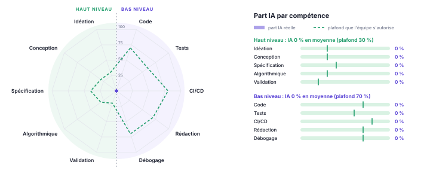

<!--
  Dossier de projet : 4 pages pour le dossier de lancement (R1), puis il s'enrichit à chaque livraison.
  Compilation : make -C doc   (pandoc + WeasyPrint ; mise en page dans style.css)
  Les commentaires HTML comme celui-ci n'apparaissent pas dans le PDF.
-->

# Équipe, comptes développeurs et dépôt

| Membre | Compte GitHub | Email des commits (`git config user.email`) |
|----------------------------|------------------------------|-----------------------------------------|
| Prénom NOM | [`@compte`](https://github.com/compte) | `email` |

Chaque membre a vérifié que son email Git est associé à son compte GitHub, pour que ses commits lui soient bien attribués. **Dépôt** : <https://github.com/ORG/REPO> · **page de projet** : <https://ORG.github.io/REPO/>.

# Projet et caractère innovant

<!-- Le problème, pour qui, ce qui existe déjà, ce qui est nouveau. L'entité pivot autour de laquelle
     les features s'organisent. En quoi l'application CALCULE des décisions au lieu de stocker des données. -->

# Scénarios d'usage

<!-- 4 à 6 scénarios « En tant que …, je …, afin de … », chacun rattaché à une feature. -->

# Plan des features

Une feature a un effet sur **la BD, le back, l'API REST et le front**. Chaque feature est portée par **une seule personne** et repose sur **un algorithme** identifié.

| Version | Membre 1 | Membre 2 | Membre 3 | Membre 4 |
|-----|---------|---------|---------|---------|
| **v0.1.0** 24/11 | Feature — *algorithme* | | | |
| **v0.2.0** 08/12 | | | | |
| **v1.0.0** 19/01 | | | | |

# Architecture

```
  Front  --HTTP/JSON-->  API REST  -->  Back (cas d'utilisation)  --JPA-->  BD
 (web)               (Spring MVC)       (Java 21, hexagonal)            (PostgreSQL)
```

| Couche | Choix | Remarques |
|--|-----|-----|
| Front | application web : HTML, CSS, JavaScript natif | client de l'API REST uniquement ; dossier `front/` |
| API REST | Spring Boot 4 (Spring MVC), OpenAPI / Swagger UI | versionnée sous `/api/v1`, erreurs au format RFC 9457 |
| Back | Java 21, Spring Boot 4, Spring Data JPA, Bean Validation | **architecture hexagonale** |
| BD | PostgreSQL 17 (H2 pour les tests) | schéma versionné par **Flyway**, une migration par feature |
| Qualité | JUnit 5, AssertJ, ArchUnit, JaCoCo, Codecov, SonarCloud | intégration continue GitHub Actions |
| Conteneurs | Docker Compose | BD dès v0.1.0, application en v0.2.0 |

<!-- Adapter ce tableau à vos choix. Décrire le modèle commun (entité pivot) fixé au départ. -->

**Qualité du code.** Au-delà de l'architecture hexagonale :

- **Clean Code** : noms métier explicites, fonctions courtes, pas de duplication, commentaires qui expliquent le *pourquoi* ;
- **SOLID**, objets valeur immuables et invariants vérifiés à la construction ;
- **design patterns** quand ils servent, nommés dans les fiches de features ;
- conventions **REST** et règles de sécurité **OWASP** ;
- *quality gate* SonarCloud au vert.

<!-- Préciser les pratiques retenues par l'équipe et leur outillage éventuel (formateur, analyseur…). -->

# Démarche pour chaque feature

Les étapes s'enchaînent **dans cet ordre, sans en sauter** : on ne commence une étape que lorsque la précédente est terminée.

| Étape | Ce qu'on fait | Terminé quand |
|--|--------|-----|
| 1. Idéation | Besoin et scénario ; **algorithme retenu**, complexité, alternatives ; impact sur le schéma et l'API ; critères d'acceptation. Issue + fiche `doc/features/`. | La fiche est validée par un autre membre. |
| 2. Back | Migration Flyway ; **domaine** en Java pur (modèle, règles, algorithme) ; **application** (ports, service) ; adaptateur de persistance. | Le code compile et ArchUnit passe. |
| 3. Tests | Unitaires de l'algorithme (cas limites, invariants, propriétés) ; services avec faux adaptateurs ; intégration de la persistance. | `./gradlew build` passe ; chaque critère d'acceptation est couvert. |
| 4. API REST | Endpoints `/api/v1`, DTO validés, erreurs `problem+json`, OpenAPI ; tests de l'API. | Visible dans Swagger UI ; tests de l'API verts. |
| 5. Front | Écrans qui consomment **uniquement** l'API. | Scénario jouable de bout en bout ; PR relue ; fiche complétée avec son araignée. |

# Protocole d'usage de l'IA

<!-- Point de départ : à discuter et adapter en équipe (voir aussi CLAUDE.md). -->

**Principe : l'IA assiste, l'humain reste l'auteur.** On ne laisse jamais l'IA tout faire sans comprendre : tout ce qui est commité a été relu et compris par son auteur, capable de l'expliquer, de le modifier et de le refaire sans aide. Les consignes des assistants de code sont versionnées dans `CLAUDE.md`.

| Activité | Ce que fait l'IA | Ce que fait l'humain |
|---|-----|-----|
| Idéation et conception | Critique les idées, propose des options | Choisit, justifie, rédige la fiche |
| Algorithme | Explique, relit, signale les cas oubliés | **Conçoit et écrit le cœur de l'algorithme** |
| Code technique | Peut générer un premier jet | Relit chaque ligne, adapte, assume |
| Tests | Suggère des cas | Définit cas limites et propriétés ; vérifie qu'un test échoue quand on casse le code |
| CI/CD, conteneurisation | Peut générer workflows et Dockerfile | Comprend chaque étape, vérifie l'exécution, gère les secrets |
| Documentation | Aide à rédiger et mettre en forme | Valide le contenu, vérifie les faits |

**Interdits.** Commiter du code qu'on ne comprend pas ; confier des secrets ou des données personnelles à l'IA ; commiter sous une autre identité ; présenter comme humain un travail de l'IA.

**Traçabilité.** Section « Usage de l'IA » dans chaque pull request. Part de l'IA déclarée **par compétence** (haut niveau / bas niveau) dans un graphe en araignée, comparée à un plafond que l'équipe s'autorise (annexe).

# Annexe : part IA / part humaine {#annexe-part-ia}

{.araignee}

Valeurs dans `doc/part-ia.json`, régénérées à chaque compilation. <!-- Commenter honnêtement les dépassements de plafond. -->
