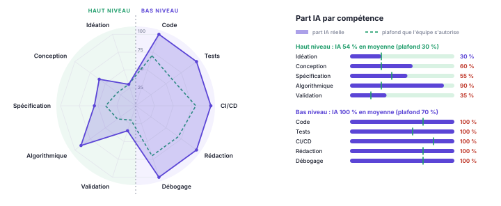

# À quoi sert ce dépôt

Ce dépôt est un **point de départ clé en main** pour le projet de M1 MIAGE Apprentissage. Il fournit :

- un **back Java 21 / Spring Boot 4** organisé en **architecture hexagonale**, avec une BD PostgreSQL dont le schéma est versionné par Flyway ;
- un **module d'exemple** complet, de la BD au front, qui montre chaque couche et chaque type de test ;
- un **front web** minimal qui ne passe que par l'API REST ;
- l'**intégration continue** (build, tests, couverture, SonarCloud, Codecov), la **release automatique** (jar + dossier PDF) à chaque tag, et des modèles d'issue et de pull request ;
- une **page de projet** publiée sur GitHub Pages ;
- le **dossier de projet** en Markdown, compilé en PDF avec une mise en page soignée ;
- un **graphe en araignée** pour déclarer la part de l'IA par compétence ;
- un fichier **`CLAUDE.md`** de consignes pour un assistant de code ;
- un **script d'initialisation** qui renomme le projet en une commande.

Le guide que vous lisez a pour source `documentation.md`, à la racine du dépôt.

# Ce qui est imposé, et ce qui ne l'est pas

**Rien dans ce dépôt n'est imposé.** Ni le template, ni le `CLAUDE.md`, ni les outils. Vous pouvez partir d'un dépôt vide, n'en reprendre que des morceaux, ou changer de framework, tant que les **règles du cours** sont respectées :

| Règles du cours (imposées) | Propositions de ce dépôt (libres) |
|-----------|-----------|
| Architecture front → API REST → back → BD, **back en Java** | Spring Boot, architecture hexagonale, ArchUnit |
| Une feature par personne et par itération, qui touche **les quatre couches** et repose sur de l'**algorithmique** | Module d'exemple, fiche de feature, modèles d'issue et de PR |
| Démarche : idéation → back → tests → API REST → front | Critères de fin de chaque étape |
| Livraisons taguées, README avec badges, CI, conteneurisation en v0.2.0 | GitHub Actions, SonarCloud, Codecov, Docker Compose |
| Une page de projet ; la documentation construite par la CI et jointe à chaque release | Squelette `site/`, workflows `pages.yml` et `release.yml` |
| | Outil de documentation (pandoc + WeasyPrint) : seul le contrat `make -C doc` compte |
| Dossier dans `/doc`, compilé en PDF | Markdown, pandoc + WeasyPrint, feuille de style, script de l'araignée |
| Commits identifiés au compte de chaque développeur | Rappels dans le README, le CONTRIBUTING et le `CLAUDE.md` |
| Usage de l'IA décrit dans un protocole, maîtrise du travail produit | `CLAUDE.md`, araignée « part IA / part humaine » |

## L'IA générative : vous êtes libres

L'usage de l'IA générative est **autorisé, pas obligatoire**, et chaque équipe l'organise comme elle l'entend. Selon les équipes, on verra par exemple :

- **aucune IA** : c'est un choix parfaitement légitime ;
- de l'IA **seulement pour les tests**, ou seulement pour la documentation ;
- un **assistant agentique** : Claude Code, ChatGPT et Codex, GitHub Copilot, Cursor… ;
- un **modèle local** avec Ollama, voire un simple modèle de **complétion de code** dans l'éditeur.

Ce qui est attendu dans tous les cas : **maîtriser ce que vous rendez**, et **décrire honnêtement** votre usage de l'IA dans le protocole du dossier. En soutenance, des questions porteront sur votre compréhension du code et des algorithmes.

Le `CLAUDE.md` fourni est une **proposition** de règles du jeu pour un assistant. Il le pousse à vous faire écrire le cœur des algorithmes, à avancer étape par étape et à vérifier votre compréhension. Vous pouvez :

- le garder tel quel avec Claude Code, qui le lit automatiquement ;
- l'adapter à votre outil : `AGENTS.md` pour Codex, `.github/copilot-instructions.md` pour Copilot, `.cursor/rules/` pour Cursor, ou le prompt système d'un modèle local ;
- le modifier, le durcir, l'alléger, ou le **supprimer** si vous n'utilisez pas d'assistant.

# Démarrage rapide

1. **Une personne de l'équipe** crée le dépôt GitHub à partir de ce modèle, puis invite les autres membres.
2. **Chaque membre** configure son identité Git, celle de **son** compte GitHub :
   `git config user.name "Prénom Nom"` puis `git config user.email "email-du-compte"`.
3. **Initialisation, une seule fois**, par une seule personne, qui commite et pousse ensuite :

   ```bash
   ./outils/initialiser.sh mon-projet "MonProjet"                      # garde l'exemple pour l'étudier
   ./outils/initialiser.sh mon-projet "MonProjet" --supprimer-exemple  # ou le retire tout de suite
   ./gradlew build                                                     # tout doit être vert
   ```

   Le script renomme le package (`fr.miage.monprojet`), la classe principale (`MonProjetApplication`), l'artefact (`mon-projet-back`), la base de données et les titres. Il refuse de s'exécuter une seconde fois.
4. Remplacer `ORG/REPO` et `SONAR_KEY` dans le README, et renseigner `gradle.properties`.
5. Brancher SonarCloud et Codecov (section suivante) : leurs jetons vont dans *Settings → Secrets and variables → Actions*. Sans eux, la CI tourne quand même, mais sans ces deux étapes.
6. Activer GitHub Pages (*Settings → Pages → Source : GitHub Actions*), puis rédiger `doc/dossier.md` et `site/index.html`.
7. **Supprimer le module d'exemple avant la première feature**, pour que celle-ci prenne la migration `V2`.

**Lancer l'application :**

```bash
docker compose up -d && ./gradlew bootRun                         # avec PostgreSQL
./gradlew bootRun --args='--spring.profiles.active=h2,demo'       # sans Docker, avec données de démo
python3 -m http.server 8000 -d front                              # front sur http://localhost:8000
```

L'API est sur `http://localhost:8080/api/v1/info`, et Swagger UI sur `/swagger-ui.html`.

# Brancher la qualité et livrer une version

## SonarCloud (qualité de code)

1. Se connecter sur <https://sonarcloud.io> avec son compte GitHub, puis **importer l'organisation** (ou le compte) qui héberge le dépôt.
2. **Analyze new project**, choisir le dépôt, puis désactiver l'*Automatic Analysis* : l'analyse est lancée par la CI.
3. Noter la **clé du projet** et l'**organisation**, et les reporter dans `gradle.properties` (`sonarProjectKey`, `sonarOrganization`) ainsi que dans le badge du README (`SONAR_KEY`).
4. Générer un jeton (*My Account → Security*) et l'ajouter au dépôt GitHub comme secret **`SONAR_TOKEN`**.

## Codecov (couverture de tests)

1. Se connecter sur <https://about.codecov.io> avec son compte GitHub et activer le dépôt.
2. Copier le jeton d'envoi (*upload token*) et l'ajouter comme secret **`CODECOV_TOKEN`**.
3. Le rapport JaCoCo (`build/reports/jacoco/test/jacocoTestReport.xml`) est envoyé à chaque build de la CI ; le badge du README s'affiche après le premier envoi.

## Publier une version : automatique

La release est **construite et publiée par l'intégration continue** (workflow `release.yml`) dès qu'un tag `v*` est poussé :

1. build et tests de l'application, avec la version du tag (`v0.1.0` donne `0.1.0`) ;
2. compilation de la documentation (`make -C doc`) ;
3. création de la release GitHub, avec en pièces jointes **le jar exécutable et `dossier.pdf`**. Un tag avec un suffixe, comme `v0.1.0-SNAPSHOT`, est publié en *pré-release*.

```bash
# avant de taguer : doc/part-ia.json et le dossier à jour, ./gradlew build vert
git tag -a v0.1.0 -m "Livraison v0.1.0" && git push origin v0.1.0
git tag -a v0.1.0-SNAPSHOT -m "Pré-livraison fin de séance" && git push origin v0.1.0-SNAPSHOT
```

Le badge de version du README affiche la dernière release. Si la release échoue, l'onglet *Actions* du dépôt indique l'étape en cause.

## Page de projet (GitHub Pages)

Chaque équipe publie une **page de projet** : présentation, fonctionnalités, équipe, dossier PDF, araignée. Le squelette est dans `site/` (HTML et CSS, sans build), à compléter et à personnaliser librement.

- **Activation, une fois** : *Settings → Pages → Source : GitHub Actions*.
- **Publication** : automatique à chaque push sur `main` (workflow `pages.yml`). La dernière version de `dossier.pdf` et de l'araignée y est ajoutée.
- **Aperçu local** : `make -C doc site`, puis ouvrir `build/site/index.html`.
- L'adresse est de la forme `https://<org>.github.io/<repo>/`. Ajoutez-la au README et au dossier.

## La documentation : outil libre, construction imposée

Ce dépôt compile le dossier avec pandoc et WeasyPrint, mais **l'outil est libre** : AsciiDoc, LaTeX, Typst, un autre générateur… La seule règle est le **contrat de construction** : la commande `make -C doc` doit produire `doc/dossier.pdf`. C'est elle qu'appellent les workflows `doc.yml`, `release.yml` et `pages.yml`. Si vous changez d'outil, adaptez `doc/Makefile` et l'installation des outils dans `.github/actions/outils-doc/action.yml`.

# Contenu du dépôt

| Chemin | Rôle |
|------|-----------|
| `src/main/java/.../<module>/` | Un domaine fonctionnel = un module hexagonal (`domain`, `application`, `adapter`, `config`) |
| `src/main/resources/db/migration/` | Migrations Flyway `V1__…`, `V2__…` ; une migration poussée ne se modifie jamais |
| `src/main/resources/db/demo/` | Jeu de démonstration idempotent, chargé par le profil `demo` |
| `src/test/java/...` | Tests unitaires `*Test`, tests d'intégration `*IT`, règles d'architecture |
| `front/` | Client web sans build ; `api.js` est le seul fichier qui connaît les URL |
| `doc/dossier.md` | Le dossier de projet, compilé en `doc/dossier.pdf` |
| `doc/features/` | Une fiche par feature, à partir de `MODELE-feature.md` |
| `doc/part-ia.json` | Les valeurs de l'araignée « part IA / part humaine » |
| `doc/style.css`, `doc/outils/` | Mise en page du PDF, générateur de l'araignée |
| `.github/` | CI, release automatique, page de projet, compilation de la documentation, modèles d'issue et de PR |
| `site/` | Page de projet publiée sur GitHub Pages |
| `outils/initialiser.sh` | Renommage initial du projet |
| `CLAUDE.md` | Consignes proposées pour un assistant de code |
| `exemples-ia/` | Exemple d'échange avec une IA : la critique d'une idée de projet |

# Le module d'exemple

Le module `exemple` gère des notes et calcule leurs mots les plus fréquents. **Ce n'est pas un modèle de feature** : son algorithme (un top-k par tas) est volontairement minuscule. Il sert à montrer, sur un cas simple :

- **les objets valeur** et les invariants vérifiés à la construction (`NoteId`, `NouvelleNote`) ;
- **un algorithme en Java pur**, avec sa complexité documentée (`MotsFrequents`) ;
- **les ports d'entrée et de sortie**, et un service sans Spring (`GestionNotesService`) ;
- **les adaptateurs** : JPA en sortie, REST en entrée, avec DTO et erreurs `problem+json` ;
- **l'assemblage** dans une classe de configuration Spring ;
- **tous les types de tests** : unitaires, propriété vérifiée sur données aléatoires à graine fixe, service avec un faux dépôt en mémoire, persistance sur le vrai schéma, API de bout en bout ;
- **une section de front** qui n'appelle que l'API.

# La démarche pour chaque feature

| Étape | Ce qu'on fait | Terminé quand |
|--|--------|-----|
| 1. Idéation | Besoin et scénario ; **algorithme retenu**, complexité, alternatives ; impact sur le schéma et l'API ; critères d'acceptation. Issue + fiche `doc/features/`. | La fiche est validée par un autre membre. |
| 2. Back | Migration Flyway ; domaine en Java pur ; application (ports, service) ; adaptateur de persistance ; assemblage. | Le code compile et ArchUnit passe. |
| 3. Tests | Algorithme (cas limites, invariants, propriétés) ; services avec faux adaptateurs ; intégration de la persistance. | `./gradlew build` passe ; chaque critère d'acceptation est couvert. |
| 4. API REST | Endpoints `/api/v1`, DTO validés, erreurs `problem+json`, OpenAPI ; tests de l'API. | Visible dans Swagger UI ; tests de l'API verts. |
| 5. Front | Écrans qui consomment **uniquement** l'API. | Scénario jouable de bout en bout ; PR relue ; fiche complétée avec son araignée. |

**L'architecture hexagonale en trois règles**, vérifiées par `ArchitectureHexagonaleTest` à chaque build :

1. `domain` ne dépend que de Java.
2. `application` ne dépend ni des adaptateurs ni de Spring.
3. Un module n'en utilise un autre que **par ses ports**.

Un sujet large s'organise autour d'une **entité pivot**, fixée dès le départ : c'est ce qui permet aux features d'une même itération d'avancer en parallèle.

# Bonnes pratiques

L'architecture hexagonale n'est qu'une partie de la qualité attendue. Les pratiques suivantes sont des **repères**, à appliquer avec discernement : un écart justifié vaut mieux qu'une règle appliquée sans la comprendre. Le module d'exemple en illustre la plupart.

| Pratique | Ce que ça veut dire | Où le voir dans l'exemple |
|------|-----------|------|
| **Clean Code** : nommage | Noms explicites, dans la langue du métier, partout identiques (code, API, dossier) | `NouvelleNote`, `motsFrequents`, `GestionNotesUseCase` |
| **Clean Code** : fonctions | Courtes, une seule chose, un seul niveau d'abstraction ; pas de duplication ni de valeur « magique » | `MotsFrequents.calculer` → `compter` puis `meilleurs` ; `LONGUEUR_MAX_TITRE` |
| **Clean Code** : commentaires | Ils expliquent le *pourquoi* ; pas de code mort ni commenté | Complexité et choix du tas dans `MotsFrequents` |
| **SOLID** | Une responsabilité par classe ; dépendre d'abstractions (les ports) ; interfaces petites | Port `NoteRepository`, service sans Spring, contrôleur sans logique |
| **Modélisation** | Objets valeur et `record` immuables ; invariants vérifiés à la construction (*fail fast*) ; exceptions métier | `NoteId`, `NouvelleNote`, `NoteIntrouvableException` |
| **Design patterns** | Quand ils servent, nommés et justifiés : Strategy, Adapter, Factory, Builder, Repository… | Adapter (`NotePersistenceAdapter`), fabriques `depuis(...)` des DTO |
| **API REST** | Ressources au pluriel ; bons verbes et codes (201 + `Location`, 400, 404, 409) ; validation ; `problem+json` ; `/api/v1` | `NoteController`, `ExempleExceptionHandler` |
| **Sécurité (OWASP)** | Valider les entrées, échapper les sorties, requêtes paramétrées, CORS restreint, aucun secret dans le dépôt | `@Valid`, `echapper()` du front, `CorsConfiguration` |
| **Tests** | Écrits avec le code, voire avant ; cas limites et propriétés ; un test doit échouer quand on casse le code | `MotsFrequentsTest`, `NoteRepositoryEnMemoire` |
| **Qualité continue** | *Quality gate* SonarCloud au vert, couverture suivie, aucun avertissement ignoré sans raison | CI `ci.yml`, badges du README |
| **Git** | Petits commits explicites, une branche et une PR par feature, relecture croisée | Modèle de PR, `CONTRIBUTING.md` |

Le `CLAUDE.md` demande à l'assistant d'appliquer ces pratiques, d'expliquer pourquoi, et de signaler les écarts en relecture. Rien n'empêche d'ajouter un formateur ou un analyseur, comme Spotless ou Checkstyle, si l'équipe le souhaite.

# Le dossier de projet

- **Source** : `doc/dossier.md`. Les commentaires HTML, qui contiennent les consignes, n'apparaissent pas dans le PDF.
- **Compilation** : `make -C doc`. Il faut pandoc et WeasyPrint (`pip install weasyprint`). La CI le compile aussi, à chaque modification de `doc/`.
- **Mise en page** : `doc/style.css`. Le dossier de lancement est limité à **4 pages**. L'araignée est placée en annexe, sur sa propre page.
- **Fiches de features** : `doc/features/<version>-F<n>-<nom>.md`. Elles enrichissent le dossier à chaque livraison.

Ce guide se compile de la même façon : `make -C doc documentation`.

# L'araignée « part IA / part humaine »

## Pourquoi une araignée plutôt qu'un pourcentage

Un pourcentage global serait biaisé : faire écrire du code par l'IA n'a pas le même poids que lui faire concevoir une solution. L'araignée sépare donc deux familles de compétences :

- le **haut niveau**, sur la moitié gauche, sur fond vert : idéation, conception, spécification, algorithmique, validation ;
- le **bas niveau**, sur la moitié droite, sur fond violet : code, tests, CI/CD, rédaction, débogage.

Sur chaque axe, la **part IA réelle** (surface violette) est comparée à un **plafond** que l'équipe s'autorise (pointillés verts), plus bas pour le haut niveau. Les plafonds fournis sont des **propositions** : à vous de les fixer en équipe, et de les justifier dans le protocole.

## Mettre à jour les valeurs

1. Modifier `doc/part-ia.json` : pour chaque axe, `ia` est la part produite par l'IA, en pourcentage.
2. Lancer `make -C doc` : l'araignée est régénérée dans le dossier.
3. Dans chaque pull request, remplir le tableau « Part IA par compétence ». Dans chaque fiche de feature, remplir son bilan.

## L'IA peut calculer les pourcentages, mais il faut vérifier

Un assistant peut proposer les valeurs : il connaît ce qu'il a produit pendant la session. Mais **ces chiffres sont à vérifier**, parce qu'un assistant oublie ce qui s'est passé dans d'autres sessions ou avec d'autres outils, et peut se tromper dans un sens comme dans l'autre. Pour vérifier :

- **Bas niveau** : comparer avec l'historique Git. `git log --numstat --author="…"` donne les lignes par auteur. Les commits produits avec l'IA peuvent être marqués, par exemple avec la mention `Co-Authored-By` ou un préfixe convenu en équipe. La section « Usage de l'IA » des PR complète le tableau.
- **Haut niveau** : il n'y a pas de compteur, c'est une estimation. Se poser des questions concrètes : *qui a eu l'idée ? qui a choisi l'algorithme, et pourquoi ? qui a écrit les critères d'acceptation ? qui a décidé que c'était terminé ?* L'estimation se discute en équipe.
- **Règle d'or** : en cas de doute, arrondir la part de l'IA **vers le haut**. Une déclaration honnête vaut mieux qu'une araignée flatteuse qui ne résisterait pas à une question en soutenance.

## Exemple : la création de ce dépôt modèle

Ce dépôt a été construit en dialogue entre un enseignant et un assistant (Claude Code). Voici l'araignée correspondante, proposée par l'assistant puis relue par l'enseignant :

{.araignee}

**Comment la lire :**

- **Côté vert (haut niveau), l'enseignant est bien présent.** Il a apporté le cadre du cours et les règles des features. Il a eu les idées structurantes : un template clé en main, puis la barre, puis l'araignée, la séparation entre haut et bas niveau, la liberté d'usage de l'IA, l'architecture hexagonale. Et il a validé ou corrigé chaque étape : refus de certaines propositions, corrections, demandes de refonte de la mise en page ou du protocole. D'où une part IA de 30 % en idéation et de 35 % en validation.
- **Côté violet (bas niveau), l'enseignant n'a aucune part.** Le code, les tests, la CI, la rédaction et le débogage ont été produits à 100 % par l'IA.
- **Les écarts au plafond sont visibles.** L'algorithmique (90 %) et la conception (60 %) dépassent nettement leur plafond : l'assistant a choisi les algorithmes de l'exemple et conçu la structure du dépôt. Pour un enseignant qui fabrique un outil, ce n'est pas un problème. Pour une équipe d'étudiants qui livre une feature, ce serait un signal d'alerte : le haut niveau, et l'algorithmique en particulier, est précisément ce qui est évalué.

Les valeurs sont dans `doc/exemples/part-ia-template.json`.

# Pièges fréquents

- **Commits mal attribués** : si `git config user.email` n'est pas associé à votre compte GitHub, votre contribution n'apparaît pas. Vérifiez avant le premier commit.
- **Migration modifiée après coup** : Flyway refuse de démarrer. Ajoutez une nouvelle migration au lieu de modifier l'ancienne.
- **Port 8080 déjà pris** : une autre instance tourne sans doute encore. Arrêtez-la, ou lancez avec `--server.port=8081` en adaptant `front/api.js`.
- **Front bloqué par le CORS** : servez-le sur `http://localhost:8000`, l'origine autorisée dans `application.properties`.
- **ArchUnit en échec** : une classe du domaine ou de l'application dépend de Spring ou d'un adaptateur. Remontez la dépendance derrière un port.
- **Dossier de plus de 4 pages** : resserrez le texte, et gardez les annexes pour l'araignée.
